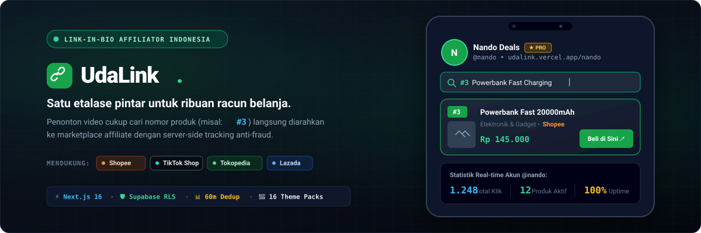
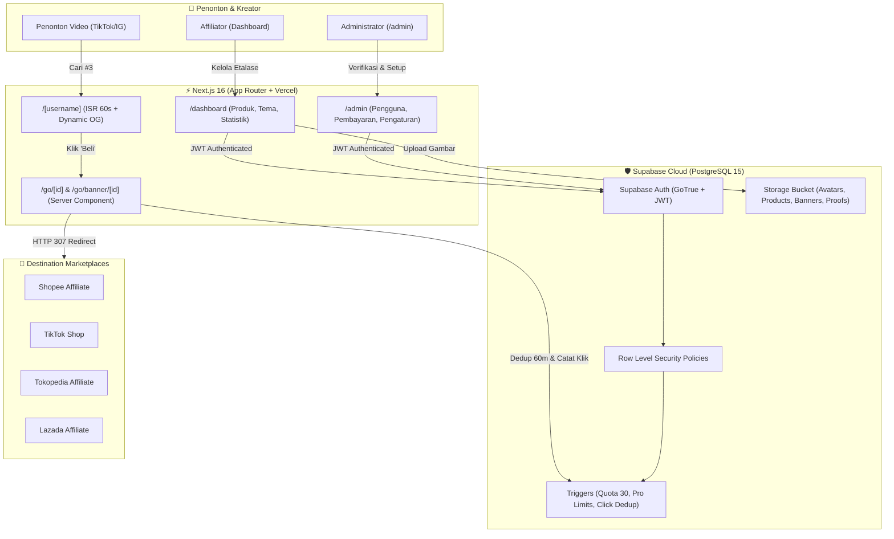

<p align="center">
  
</p>

<p align="center">
  <a href="https://nextjs.org"></a>
  <a href="https://www.typescriptlang.org"></a>
  <a href="https://supabase.com"></a>
  <a href="https://tailwindcss.com"></a>
  <a href="https://vercel.com"></a>
  <a href="#lisensi"></a>
</p>

<p align="center">
  <strong>UdaLink</strong> adalah platform <em>link-in-bio</em> modern yang dirancang spesifik untuk kebutuhan <strong>content creator dan affiliator Indonesia</strong> (Shopee, TikTok Shop, Tokopedia, dan Lazada). Solusi praktis agar audiens video cukup mengetik nomor produk untuk langsung menemukan tautan pembelian asli.
</p>

<p align="center">
  <a href="https://udalink.vercel.app"><strong>🌐 Buka Aplikasi Live</strong></a> •
  <a href="https://udalink.vercel.app/nando"><strong>📱 Demo Etalase (@nando)</strong></a> •
  <a href="#panduan-setup-lokal"><strong>⚡ Panduan Setup</strong></a> •
  <a href="#arsitektur-sistem"><strong>🏗️ Arsitektur</strong></a>
</p>

---

## 💡 Latar Belakang & Masalah

Pada platform seperti TikTok, Instagram Reels, dan YouTube Shorts, kreator sering membagikan konten review produk dengan instruksi seperti:
> *"Spill barangnya ada di bio nomor 3 ya!"*

Namun, layanan *link-tree* konvensional memiliki kelemahan mendasar:
1. **Audiens Tersesat**: Pengunjung harus menggulir puluhan tautan teks secara manual tanpa fitur pencarian nomor yang presisi.
2. **Statistik Tidak Akurat (Click Fraud)**: Refresh browser atau double-click berulang menghitung klik ganda dan merusak analisis data konversi.
3. **Keterbatasan Personalisasi**: Etalase terlihat generik tanpa visual produk, kategori, dan banner promosi yang menarik.
4. **Keamanan Link Rentan**: Client-side redirect mudah dibypass dan rawan kebocoran tracking affiliate.

**UdaLink menyelesaikan seluruh masalah ini** dengan etalase visual responsif, server-side tracking terproteksi dengan deduplikasi sesi 60 menit, serta sistem pencarian nomor otomatis.

---

## ✨ Fitur Unggulan

| Modul | Fitur Utama | Rincian Teknis |
|---|---|---|
| **Pencarian Nomor Cerdas** | Pencarian instan berbasis query fleksibel | Menangani `#3`, `nomor 3`, `no 3`, `3.`, nama produk, dan filter kategori secara *real-time*. |
| **Server-Side Tracking** | Redirection aman di server (`/go/[id]`) | Mencegah bot, mencatat IP/sesi anonim, dan menerapkan **deduplikasi 60 menit** per sesi penonton. |
| **16 Tema Visual** | Pilihan tema etalase modern | 4 tema gratis + 12 tema eksklusif Pro (Hijau, Lavender, Sunset, Emerald, Neon, Retro, dsb). |
| **Multi-Metode Pembayaran** | Pembayaran langganan fleksibel | Dukungan transfer bank (BCA, Mandiri, BRI, BNI), QRIS, dan e-Wallet dengan kode unik 3 digit verifikasi instan. |
| **Panel Admin Terpadu** | Manajemen operasional lengkap | Verifikasi bukti transfer, kelola status Pro/Suspend, pengaturan rekening, serta fitur tambah akun admin baru. |
| **Keamanan Berlapis** | Database-level constraints | PostgreSQL Row Level Security (RLS) & triggers mengunci batas 30 produk (Free), banner, dan produk unggulan. |
| **Optimasi SEO & Caching** | Indeksasi mesin pencari & media sosial | Dynamic Open Graph & Twitter Cards per etalase, ISR edge caching 60 detik, `robots.txt`, dan `sitemap.xml`. |

---

## 🏗️ Arsitektur Sistem



---

## 🗂️ Matriks Peran Pengguna

| Fitur / Hak Akses | Akun Gratis (Free) | Akun Pro | Akun Administrator |
|---|:---:|:---:|:---:|
| Batas Jumlah Produk | **Maksimal 30 Produk** | **Tanpa Batas (Unlimited)** | Tanpa Batas |
| Penomoran Produk Otomatis (`#1`, `#2`, ...) | ✅ Ya | ✅ Ya | ✅ Ya |
| Pilihan Tema Desain | 4 Tema Dasar | **16 Tema Lengkap** | Semua Tema |
| Banner Promosi Berjalan | ❌ Tidak | **Hingga 5 Banner** | Kelola Semua |
| Produk Unggulan di Puncak Etalase | ❌ Tidak | **Hingga 3 Produk** | Kelola Semua |
| Tombol WhatsApp Floating | ❌ Tidak | ✅ Ya | ✅ Ya |
| Verifikasi Pembayaran Langganan | ❌ Tidak | ❌ Tidak | ✅ Penuh |
| Kelola Pengguna & Tambah Admin Baru | ❌ Tidak | ❌ Tidak | ✅ Penuh |

---

## ⚡ Panduan Setup Lokal

### 1. Prasyarat Sistem
- **Node.js**: versi LTS `v20.x` atau `v22.x` disarankan
- **Package Manager**: `npm`, `pnpm`, atau `yarn`
- **Database**: Akun Supabase gratis di [supabase.com](https://supabase.com)

### 2. Kloning Repository
```bash
git clone https://github.com/letdebbycook/UdaLink.git
cd UdaLink
npm install
```

### 3. Konfigurasi Environment Variables
Salin template konfigurasi `.env.example` menjadi `.env.local`:
```bash
cp .env.example .env.local
```

Buka `.env.local` dan lengkapi kredensial Supabase Anda (didapatkan dari **Project Settings → API**):
```env
NEXT_PUBLIC_SUPABASE_URL=https://your-project-id.supabase.co
NEXT_PUBLIC_SUPABASE_ANON_KEY=eyJhbGciOi...
NEXT_PUBLIC_SITE_URL=http://localhost:3000
```

> [!WARNING]
> **Keamanan Kunci:** Jangan pernah memasukkan `service_role key` ke `.env.local` atau kode client. Seluruh operasi client di UdaLink terisolasi secara aman menggunakan **Row Level Security (RLS)** dan `anon key`.

---

## 🗄️ Setup Database & Eksekusi Skrip Supabase

Buka **Supabase Dashboard → SQL Editor**, lalu jalankan file skrip berikut secara berurutan:

1. **[supabase/schema.sql](supabase/schema.sql)** *(Wajib)*:
   Membangun struktur 8 tabel utama, relasi, RLS policies, trigger nomor produk otomatis, dan fungsi RPC dasar.
2. **[supabase/bugfix-click-dedup.sql](supabase/bugfix-click-dedup.sql)** *(Wajib)*:
   Menambahkan kolom sesi pelacakan klik dan fungsi `record_click` dengan proteksi deduplikasi 60 menit.
3. **[supabase/bugfix-security-and-limits.sql](supabase/bugfix-security-and-limits.sql)** *(Wajib)*:
   Memasang trigger proteksi database untuk memvalidasi kuota 30 produk Free, produk unggulan Pro, dan banner Pro.
4. **[supabase/feature-add-admin.sql](supabase/feature-add-admin.sql)** *(Wajib)*:
   Mendaftarkan fungsi `admin_create_admin` dan `admin_set_role` untuk manajemen akun admin dari antarmuka web.
5. **[supabase/seed-dev.sql](supabase/seed-dev.sql)** *(Opsional - Data Uji Coba)*:
   Membuat profil affiliator demo `@nando` lengkap dengan 4 kategori, 12 produk dummy (#1 s/d #12), dan 2 banner promo.

---

## 🔑 Kredensial Uji Coba (Development)

Jika Anda telah menjalankan skrip seeding `seed-dev.sql`:

### 1. Akun Affiliator Demo (Pro)
- **Halaman Etalase Publik**: `http://localhost:3000/nando`
- **Email**: `nando@udalink.id`
- **Password**: `nando123`
- **Dashboard**: `http://localhost:3000/dashboard`

### 2. Akun Administrator
- **Email**: `admin@gmail.com` *(atau `admin@udalink.id`)*
- **Password**: `AdminUdaLink1!`
- **Panel Admin**: `http://localhost:3000/admin`

*(Untuk membuat admin baru, login menggunakan akun di atas lalu buka menu **Kelola Pengguna → Tambah Admin**).*

---

## 🧪 Pengujian & Verifikasi

UdaLink dilengkapi skrip verifikasi otomatis untuk memastikan integritas API dan isolasi multi-tenant:

```bash
# 1. Jalankan pengujian API dan koneksi Supabase Storage
node supabase/tests/verify-api.js

# 2. Verifikasi seluruh indeks performa database
node supabase/tests/verify-sprint4.js

# 3. Jalankan type-check dan build produksi Next.js
npm run build
```

Matriks pengujian RLS tambahan dapat dijalankan di SQL Editor melalui file:
- `supabase/tests/test-sprint-1.sql` (Verifikasi tabel, RLS, dan storage)
- `supabase/tests/test-sprint-2.sql` (Verifikasi etalase dan pencatatan klik)
- `supabase/tests/test-sprint-3.sql` (Verifikasi alur approval pembayaran)
- `supabase/tests/test-sprint-4-security-matrix.sql` (Audit hak akses 6 persona)

---

## 🚀 Panduan Deployment ke Vercel

1. Hubungkan repository GitHub Anda ke [Vercel](https://vercel.com).
2. Tambahkan **Environment Variables** pada Vercel Project Settings:
   - `NEXT_PUBLIC_SUPABASE_URL` = `https://<project-id>.supabase.co`
   - `NEXT_PUBLIC_SUPABASE_ANON_KEY` = `<anon-key>`
   - `NEXT_PUBLIC_SITE_URL` = `https://udalink.vercel.app` (domain Vercel Anda)
3. Pada **Supabase Dashboard** (**Authentication → URL Configuration**):
   - Atur **Site URL** ke domain Vercel Anda (`https://udalink.vercel.app`).
   - Daftarkan **Redirect URLs**:
     - `https://udalink.vercel.app/**`
     - `http://localhost:3000/**` (untuk pengujian lokal)

---

## 📂 Struktur Direktori

```text
udalink/
├── assets/readme/            # Asset visual dokumentasi (hero vector SVG)
├── src/
│   ├── app/
│   │   ├── (admin)/admin/    # Panel Admin (Ringkasan, Pembayaran, Pengguna, Pengaturan)
│   │   ├── (auth)/           # Autentikasi (Masuk, Daftar, Lupa Password)
│   │   ├── (dashboard)/      # Dashboard Affiliator (Produk, Kategori, Tampilan, Langganan)
│   │   ├── [username]/       # Etalase publik affiliator (Dynamic ISR route)
│   │   ├── go/[id]/          # Server-side product click tracking & redirect
│   │   ├── go/banner/[id]/   # Server-side banner click tracking & redirect
│   │   ├── kebijakan-privasi/# Halaman Kebijakan Privasi
│   │   ├── syarat-ketentuan/ # Halaman Syarat & Ketentuan Layanan
│   │   ├── robots.ts         # Next.js Metadata Route (robots.txt)
│   │   └── sitemap.ts        # Next.js Metadata Route (sitemap.xml)
│   ├── components/
│   │   ├── landing/          # Komponen landing page publik & phone mockup
│   │   ├── showcase/         # Komponen etalase publik (ShowcaseView, SafeProductImage)
│   │   └── ui/               # Design system komponen UI (shadcn/ui base)
│   ├── lib/                  # Utilitas Supabase client, helper mata uang, format tanggal
│   └── types/                # Definisi TypeScript database & state model
└── supabase/                 # Skrip migrasi SQL, patch keamanan, RPC, dan test suite
```

---

## 📄 Lisensi

Didistribusikan di bawah Lisensi MIT. Lihat file `LICENSE` untuk informasi lebih lanjut.
